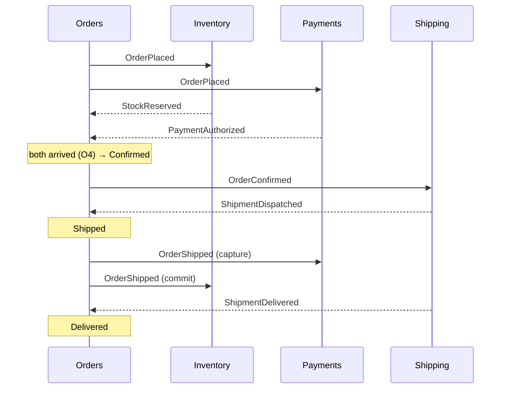

# Kafka EDA Study — Business Rules

## Purpose and scope

A small e-commerce order system built only to study event-driven design with Kafka. Every business rule exists because it exercises one concept.

- **In scope:** Orders, Inventory, Payments, Shipping, Notifications.
- **Out of scope:** catalog service, price changes, fraud review, returns, real payment or email providers.
- **Optional extra:** event sourcing, only after the core roadmap is done.

## Core concepts

Each concept below shows up in a concrete place in the domain.

| Concept | Meaning | Where it shows up |
| --- | --- | --- |
| Event | A fact that already happened, named in past tense, immutable | `OrderPlaced`, `PaymentCaptured` |
| Command | A request for something to happen; it can be rejected | `ReserveStock`, `CapturePayment` (orchestration step) |
| Event-carried state | The event carries the data consumers need, so they don't call back | `OrderPlaced` carries the order lines |
| Bounded context | A part of the business with its own model and language | Orders, Inventory, Payments, Shipping, Notifications |
| Eventual consistency | Services agree eventually, not instantly | An order stays Pending until stock and payment answer |
| Choreography | Services react to each other's events, no coordinator | Order flow v1 |
| Orchestration | A coordinator sends commands and tracks progress | Order flow v2, compared with v1 |
| Compensation | Undo a step with a new event; the past is never deleted | `StockReleased` after `PaymentDeclined` |
| Idempotency | Processing a message twice has the same effect as once | A duplicate `PaymentAuthorized` changes nothing |
| Ordering | Kafka orders messages only within a partition | Every event of an order uses key = `orderId` |
| Outbox | State change and event are saved atomically | Orders saves the order and `OrderPlaced` together |
| CQRS | A separate read model built from events | "My orders" view, sales per product |
| Schema evolution | Events change without breaking consumers | `OrderPlaced` v2 adds `couponCode` |
| Dead letter | A message that can never be processed is set aside | `OrderPlaced` with an unknown SKU |
| Event sourcing (optional) | State is rebuilt by replaying events | Order rebuilt from its event stream |

## Bounded contexts

In the order flow, services never call each other synchronously; they talk only through events.

| Context | Owns | Never knows about |
| --- | --- | --- |
| Orders | Order lifecycle and status; starts the flow | Stock levels, payment details |
| Inventory | Stock levels, reservations, releases | Money |
| Payments | Authorization, capture, void, refund | Stock |
| Shipping | Shipments, dispatch, delivery | Payment and stock |
| Notifications | Messages to the customer (logged, not sent) | Publishes no business events |

## Ubiquitous language

| Term | Meaning |
| --- | --- |
| Customer | Who places the order; identified by `customerId` only |
| Order | A customer's purchase request with one or more lines |
| Order line | One SKU, a quantity and the unit price sent at checkout |
| SKU | Product code from a fixed seed list |
| Reservation | Stock held for an order until committed, released or expired |
| Authorization | Money held on the customer's payment method, not yet taken |
| Capture | Taking the authorized money |
| Void | Cancelling an authorization before capture |
| Refund | Returning captured money |
| Shipment | The physical delivery of a confirmed order |
| Correlation ID | One ID shared by every event of the same order flow |

## Business rules

Each rule is enforced by exactly one context. Timeouts are 15 minutes in production and 30 seconds in the local study setup.

### Orders

| ID | Rule |
| --- | --- |
| O1 | An order has at least 1 line; each line has quantity 1 to 10 |
| O2 | Unit prices come in the order request and are stored with the order; products are a fixed seed list |
| O3 | Status moves only Pending → Confirmed → Shipped → Delivered, or Pending/Confirmed → Cancelled |
| O4 | An order becomes Confirmed only after both `StockReserved` and `PaymentAuthorized`, in any order |
| O5 | An order not confirmed within the timeout is cancelled automatically (reason: timeout) |
| O6 | The customer can cancel until the order is Shipped |

### Inventory

| ID | Rule |
| --- | --- |
| I1 | Reserve all lines of an order or none |
| I2 | A reservation not committed within the timeout expires and is released |
| I3 | Stock never goes negative |
| I4 | A cancelled order releases its reservation; a shipped order commits it |

### Payments

| ID | Rule |
| --- | --- |
| P1 | Authorize when the order is placed; capture only when it ships |
| P2 | Orders with a total above 1,000 are declined (simulated gateway) |
| P3 | Cancel before capture voids the authorization; cancel after capture refunds |
| P4 | The same order is never authorized or captured twice |

### Shipping

| ID | Rule |
| --- | --- |
| S1 | A shipment is created only for Confirmed orders |
| S2 | Dispatch and delivery are triggered manually (simulated carrier) |

### Notifications

| ID | Rule |
| --- | --- |
| N1 | Notify on placed, confirmed, cancelled (with reason), shipped and delivered |
| N2 | Never notify twice for the same event |

## Events catalog

Every event has one publisher and at least one consumer. Notifications consumes the customer-facing events listed in N1.

| Event | Publisher | Consumers | Key payload |
| --- | --- | --- | --- |
| OrderPlaced | Orders | Inventory, Payments, Notifications | customerId, lines (sku, qty, unitPrice), total |
| OrderConfirmed | Orders | Shipping, Notifications | orderId |
| OrderCancelled | Orders | Inventory, Payments, Notifications | reason (out_of_stock, payment_declined, timeout, customer) |
| OrderShipped | Orders | Inventory, Payments, Notifications | shipmentId |
| OrderDelivered | Orders | Notifications | deliveredAt |
| StockReserved | Inventory | Orders | reservationId, expiresAt |
| StockReservationFailed | Inventory | Orders | missing SKUs |
| StockReleased | Inventory | (read models) | reservationId, reason |
| StockCommitted | Inventory | (read models) | reservationId |
| PaymentAuthorized | Payments | Orders | authorizationId, amount |
| PaymentDeclined | Payments | Orders | reason |
| PaymentCaptured | Payments | (read models) | amount |
| PaymentVoided | Payments | (read models) | authorizationId |
| PaymentRefunded | Payments | (read models) | amount |
| ShipmentCreated | Shipping | (read models) | shipmentId |
| ShipmentDispatched | Shipping | Orders | trackingCode |
| ShipmentDelivered | Shipping | Orders | deliveredAt |

**Envelope** (same for every event): `eventId`, `eventType`, `version`, `occurredAt`, `orderId` (also the Kafka key), `correlationId`, `causationId`, `payload`.

## Key flows

The happy path is the reference; every failure flow ends in compensation events, never in deleted data.

Stock and payment may answer in either order. Notifications listens to the same events and is left out of the picture.

| Flow | Trigger | What happens |
| --- | --- | --- |
| 2. Out of stock | `StockReservationFailed` | Orders publishes `OrderCancelled` (out_of_stock); Payments voids the authorization if it exists |
| 3. Payment declined | `PaymentDeclined` | Orders publishes `OrderCancelled` (payment_declined); Inventory releases the reservation |
| 4. Timeout | Order still Pending after the timeout | Orders publishes `OrderCancelled` (timeout); Inventory releases, Payments voids |
| 5. Customer cancel | Cancel before Shipped | `OrderCancelled` (customer); Inventory releases, Payments voids |
| 6. Duplicates and late events | Same event twice, or `StockReserved` after `OrderCancelled` | Duplicates are ignored by event ID; a late reservation is released immediately |

## Study roadmap

Twelve steps, each pairing one concept with the rule or flow that exercises it.

| Step | Concept | Exercised by |
| --- | --- | --- |
| 1 | Events vs commands, pub/sub | O1; `OrderPlaced` consumed by Notifications (N1) |
| 2 | Keys, partitions, ordering | O3 status machine per `orderId` |
| 3 | Consumer groups and scaling | Inventory running 3 instances |
| 4 | Delivery semantics and idempotency | P4, N2, flow 6 |
| 5 | Errors, retries, dead letter | Poison `OrderPlaced` with an unknown SKU |
| 6 | Transactional outbox | O1 + `OrderPlaced` saved atomically |
| 7 | Choreography saga and compensation | Flows 1–3, O4 |
| 8 | Timeouts | O5, I2, flow 4 |
| 9 | Orchestration saga | Flows 1–5 again with a coordinator; compare with step 7 |
| 10 | CQRS read models | "My orders" view, sales per product |
| 11 | Schema evolution | `OrderPlaced` v2 with `couponCode` |
| 12 | Observability | One order traced across all services by `correlationId` |
| Extra | Event sourcing (optional) | Order rebuilt from its events |
