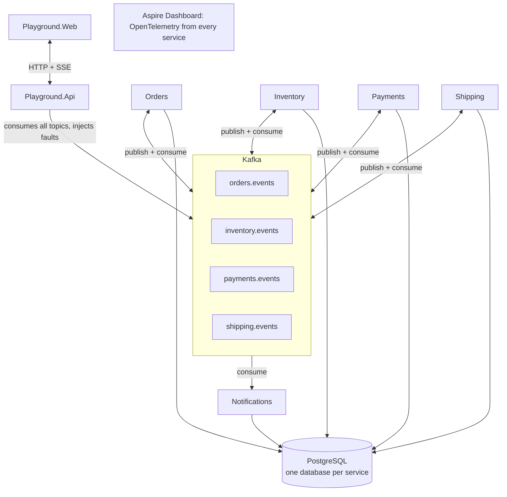

# Kafka EDA Study — Tech Stack

## Principles

- **Small:** one domain, one codebase, grown step by step; each roadmap step ends with a git tag (`step-01-pubsub`, `step-02-partitions`, …).
- **Raw Kafka:** use `Confluent.Kafka` directly, no messaging framework, so the concepts stay visible in code.
- **One command:** `docker compose up` runs everything; any service can also run with `dotnet run` against the infra in compose.
- **Observable:** every flow can be watched in the Playground UI, Kafka UI and the Aspire Dashboard.

## Stack

| Concern | Choice | Why |
| --- | --- | --- |
| Runtime | .NET 10 (LTS), C# 14, `.slnx` solution, Central Package Management | Current LTS |
| Kafka client | `Confluent.Kafka` | Official client; exposes offsets, partitions, commits |
| Broker | `apache/kafka` 4.x, KRaft mode, 1 broker | No ZooKeeper; enough for study |
| Kafka GUI | `kafbat/kafka-ui` | Inspect topics, messages, consumer groups |
| Database | PostgreSQL 17, one database per service | Outbox, inbox and service state |
| Data access | EF Core 10 + Npgsql, migrations on startup | Transactions for outbox and inbox |
| Serialization | JSON (`System.Text.Json`) with a versioned envelope | No Schema Registry, to stay small |
| APIs | ASP.NET Core Minimal APIs + OpenAPI (Scalar UI) | Little ceremony |
| Background work | `BackgroundService` | Consumers, outbox relay, timeout scanner |
| Observability | OpenTelemetry → standalone .NET Aspire Dashboard | Traces, logs and metrics in one place |
| Frontend | React 19, Vite, TypeScript, Tailwind v4, shadcn/ui, TanStack Query | The EDA Playground |
| Live updates | Server-Sent Events (`TypedResults.ServerSentEvents`) | Built into .NET 10; one-way stream is enough |
| Tests | xUnit v3 + Testcontainers (Kafka, PostgreSQL) | Real broker and database in tests |

## Architecture

No business service calls another; Kafka is the only path between them.



Each service writes its events to its own database first (outbox), then a relay publishes them to its topic.

### Solution layout

```
kafka-eda-study/
├── docker-compose.yml
├── Directory.Build.props
├── Directory.Packages.props
├── KafkaEdaStudy.slnx
├── docs/
├── src/
│   ├── BuildingBlocks/        envelope, producer, consumer base, outbox, inbox, OTel
│   ├── Contracts/             event records per context
│   ├── Orders.Api/
│   ├── Inventory.Worker/
│   ├── Payments.Worker/
│   ├── Shipping.Api/
│   ├── Notifications.Worker/
│   ├── Orders.Orchestrator/   added in step 9
│   ├── Playground.Api/
│   └── Playground.Web/        React + Vite + shadcn/ui
└── tests/
    ├── Orders.UnitTests/
    ├── Inventory.UnitTests/
    └── IntegrationTests/      Testcontainers, flows 1–6
```

## Kafka design

One topic per publishing context, keyed by `orderId`, so all events of an order stay in order.

| Topic | Publisher | Partitions | Dead-letter topic |
| --- | --- | --- | --- |
| `orders.events` | Orders | 3 | `orders.events.dlq` |
| `inventory.events` | Inventory | 3 | `inventory.events.dlq` |
| `payments.events` | Payments | 3 | `payments.events.dlq` |
| `shipping.events` | Shipping | 3 | `shipping.events.dlq` |

- **Key:** `orderId` on every message.
- **Headers:** `event-type`, `event-version`, `correlation-id`, `causation-id`, `traceparent`.
- **Consumer groups:** one per service (`inventory`, `payments`, `orders`, `shipping`, `notifications`, `playground`).
- **Consumer:** auto-commit off; commit the offset after processing (at-least-once).
- **Producer:** `Acks=All`, `EnableIdempotence=true`.
- **Topic creation:** auto-create is disabled; a one-shot `kafka-init` container creates topics explicitly.

## Patterns in code

| Pattern | Implementation | Lives in |
| --- | --- | --- |
| Transactional outbox | State change + outbox row in one EF transaction; a relay `BackgroundService` publishes and marks rows sent | BuildingBlocks, used by Orders, Inventory, Payments, Shipping |
| Inbox / idempotency | `processed_messages(event_id, consumer)` written in the handler's transaction; duplicates are skipped | BuildingBlocks, used by every consumer |
| Retries and DLQ | 3 in-process retries with backoff, then publish to `<topic>.dlq` with error headers and commit | BuildingBlocks consumer base |
| Timeouts | Scanner `BackgroundService` cancels Pending orders and expires reservations past the timeout | Orders, Inventory |
| Saga state | Order row tracks `stockReserved` and `paymentAuthorized` flags (O4) | Orders (choreography), Orders.Orchestrator (step 9) |
| CQRS read model | `order_summaries` table built only from consumed events | Orders |
| Tracing | `traceparent` header propagated producer → consumer; OpenTelemetry spans per handler | BuildingBlocks |

## Frontend: EDA Playground

A study tool, not a shop: click a scenario and watch its events move between services live. `Playground.Api` only observes Kafka, so the business services don't know the UI exists.

| Screen | What it shows | Actions |
| --- | --- | --- |
| Live stream | Every event, color-coded by context; click one for key, partition, offset, headers, JSON | Scenario buttons for flows 1–6, filters, pause |
| Order detail | Status machine with the current state; swimlane timeline with cause → effect arrows (`causationId`) | Cancel, dispatch, deliver; open trace in Aspire Dashboard |
| Kafka internals | Partition per order, consumer lag per group and partition, DLQ messages | — |
| Service state | Stock and reservations, orders from the read model | — |

Scenario buttons: place valid order, out-of-stock order, order over payment limit, order that times out, cancel order, dispatch, deliver, re-send duplicate event, send poison message.

## Docker Compose

| Service | Image / project | Port |
| --- | --- | --- |
| kafka | `apache/kafka` 4.x | 9092 |
| kafka-init | `apache/kafka` (one-shot topic creation) | — |
| kafka-ui | `kafbat/kafka-ui` | 8080 |
| postgres | `postgres:17` | 5432 |
| aspire-dashboard | `mcr.microsoft.com/dotnet/aspire-dashboard` | 18888 |
| orders-api | Orders.Api | 5001 |
| inventory-worker | Inventory.Worker | — |
| payments-worker | Payments.Worker | — |
| shipping-api | Shipping.Api | 5002 |
| notifications-worker | Notifications.Worker | — |
| playground-api | Playground.Api | 5003 |
| playground-web | Playground.Web on nginx, proxies `/api` | 3000 |

- `docker compose up -d --build` runs everything; `docker compose up -d kafka kafka-init kafka-ui postgres aspire-dashboard` runs only the infra for IDE debugging.
- Each .NET service has a multi-stage Dockerfile (`sdk:10.0` → `aspnet:10.0`) and a healthcheck; services wait with `depends_on: condition: service_healthy`.
- Timeouts are 30 seconds in compose so the timeout flows can be watched.
